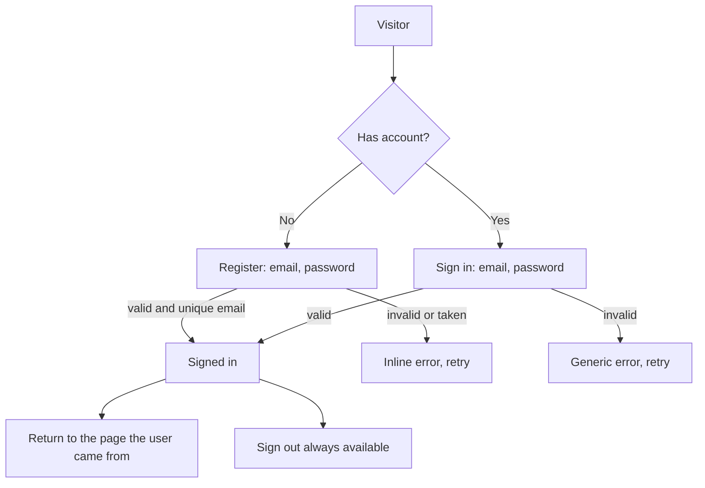
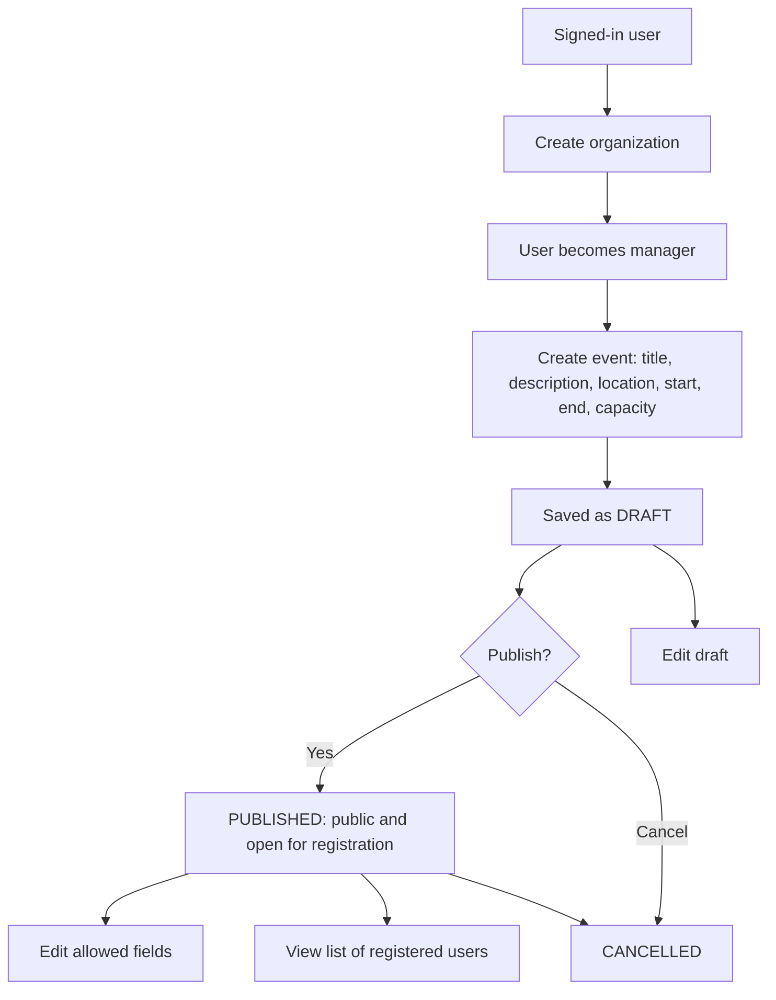
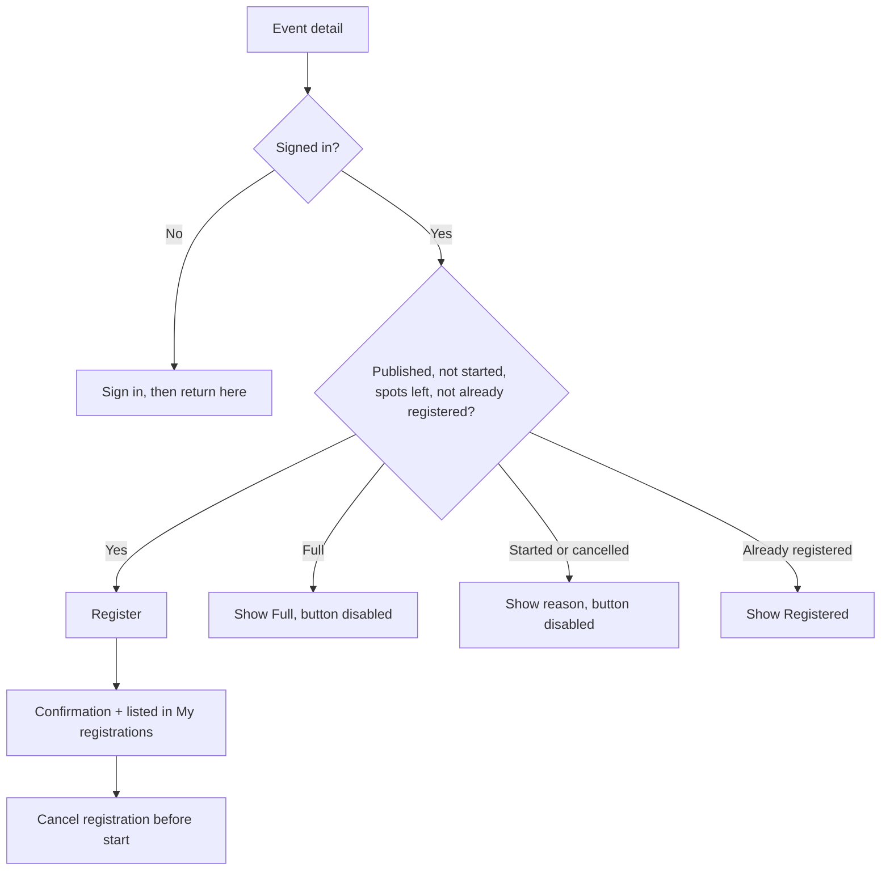

# Product flows, wireframes and usability


## 1. Flows (consistent with the MVP scope)

Scope reminders from `docs/requirements.md`: email + password auth; any authenticated user can create an organization and becomes its manager; event states `DRAFT`, `PUBLISHED`, `CANCELLED`; no waitlist, attendance, or notifications in the MVP.

### 1.1 Authentication (FR-01, FR-02)



Browsing and viewing published events needs no account. Register, create organization, and manage events require sign-in; the user returns to the original page after signing in.

### 1.2 Organization and event management (FR-03 to FR-08)



Non-managers never see manage actions; the backend rejects them anyway.

### 1.3 Event discovery (FR-09, FR-10)

1. Open the public event list: upcoming published events by start date.
2. Search by text; filter by date range, organization, and "spots available".
3. Open an event: title, description, location, start/end, organization, capacity and remaining spots, status.
4. No results: show a message and a "clear filters" action.

### 1.4 Registration (FR-11 to FR-14)



## 2. Low-fidelity wireframes

Event list:

```
+--------------------------------------------------+
| UBB Events          [Search..........] [Sign in] |
| Filters: [Date v] [Organization v] [x Spots left]|
|--------------------------------------------------|
| Intro to Git            Sat 12 Dec, 10:00        |
|  Computer Science Club  12/30 registered         |
|--------------------------------------------------|
| Board games night       Fri 18 Dec, 18:00        |
|  Sociology Society      FULL                     |
+--------------------------------------------------+
```

Event detail:

```
+--------------------------------------------------+
| < Back to events                                 |
| Intro to Git                          [Open]     |
| Sat 12 Dec, 10:00-12:00 | Room A12               |
| Organized by Computer Science Club               |
| Description ...                                  |
| 12 of 30 spots taken                             |
| [ Register ]                                     |
+--------------------------------------------------+
```

Create event (manager):

```
+--------------------------------------------------+
| Create event                                     |
| Title*        [............................]     |
| Description*  [............................]     |
| Location*     [............................]     |
| Starts*       [date] [time]                      |
| Ends*         [date] [time]                      |
| Capacity*     [ 30 ]                             |
| [ Save draft ]                                   |
+--------------------------------------------------+
```

## 3. Accessibility and usability considerations

- Semantic HTML, labelled inputs, visible focus, full keyboard operation.
- Contrast of at least WCAG AA; status is shown as text (Full, Open, Cancelled), not only color.
- Errors appear next to the field and say how to fix them; success and failure of actions are visible.
- Works on desktop and a narrow mobile viewport; touch targets at least 44 px.
- Dates are shown in the user's local timezone (demo default `Europe/Bucharest`).
- Every data screen has loading, empty, and error states.
- Short forms; only data needed for the flow.
- UI language (Romanian and/or English) decided from the interviews.
